# Codex of Conquest — feature guide

A tour of the game in pictures: the player's process from a new character to a saved run, what each feature is, why it exists, and how it fits the whole. Played by `src/tools/feature-guide.mjs` on 2026-10-20 in headless Chromium against this repository's `play.html`, with a fresh browser profile, and written with what was on the screen. The dice were real, so another run will meet other monsters and roll other numbers. Run `node src/tools/feature-guide.mjs` to play it again.

> **How the pictures were made.** Every picture marked as played was captured from the live game while the tour played it: the clicks are a player's clicks, and the rolls are the game's own. To head for the inn the tour called the same function the quest log's Navigate button calls (`storySetWaypoint`), and it closed any story card that opened on the way, as a player clicking Continue would. Pictures it could not reach in its time budget are reused from the README and say so. The VM that ran it has no emoji font, so the game's emoji icons show as small boxes.

For the README's player guide and the screenshots of single surfaces, see the [README](../README.md).

## Contents

1. [Opening the file: one page, no install](#part-1)
2. [Character creation: an origin and a 27-point budget](#part-2)
3. [Birka: reading the screen](#part-3)
4. [People: talk, and favour](#part-4)
5. [Skill checks, rolled in the open](#part-5)
6. [Quests and the Warrant's Board](#part-6)
7. [The map, and walking](#part-7)
8. [Resting: the clock, and the inn](#part-8)
9. [Combat: the d20, shown](#part-9)
10. [Levelling up: roll the hit die yourself](#part-10)
11. [Dying, and the checkpoint](#part-11)
12. [The bag and the character sheet](#part-12)
13. [The journal, and the save](#part-13)
14. [How it fits together](#part-14)

## 1. Opening the file: one page, no install

**Why it exists.** The whole game is meant to be carried around: emailed, put on a USB stick, served from any static host. So there is nothing to install and no account; the browser is the machine and its `localStorage` is the save slot.

**How it fits.** Everything in this guide happens inside this one page. The save it reads here is the same one every later part writes to.

`play.html` is 39,553 lines of HTML, CSS and JavaScript: combat engine, world map, NPC dialogue, quests and saves. Open it from disk or from <https://vonglurt.github.io/codexofconquest/>. The very first visit has no save, so it starts at once in Birka with the plain sheet (str 10, dex 8, con 8, int 8, wis 8, cha 8). From then on it opens on this choice.

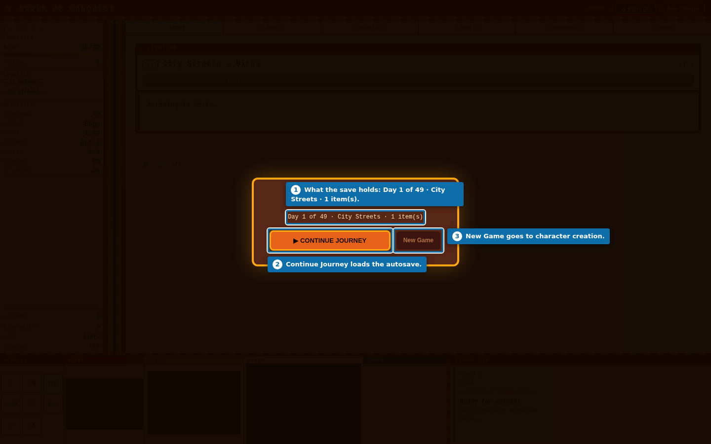

*The second visit: continue the run, or start a new one.*

1. What the save holds: Day 1 of 49 · City Streets · 1 item(s).
2. Continue Journey loads the autosave.
3. New Game goes to character creation.

## 2. Character creation: an origin and a 27-point budget

**Why it exists.** The tabletop rules are the point of the game, and they start here. Point-buy shows every cost before you pay it, so the sheet you carry for 49 days is one you chose with your eyes open.

**How it fits.** Every roll later in the game adds one of these six modifiers. Constitution also sets your hit points (a level 1 Fighter has 10 + CON modifier), and the starting scores are kept as the first tattoo, "Origin".

You play one Human Fighter Champion, level 1 to 20. **Custom Build** spends a 27-point budget, each score between 8 and 15; **Hard Mode** starts at STR 10 and 8 in everything else. The **Standard Array** button fills in 15 · 14 · 13 · 12 · 10 · 8, ordered for a fighter, and the steppers stay live. The tour took the array.

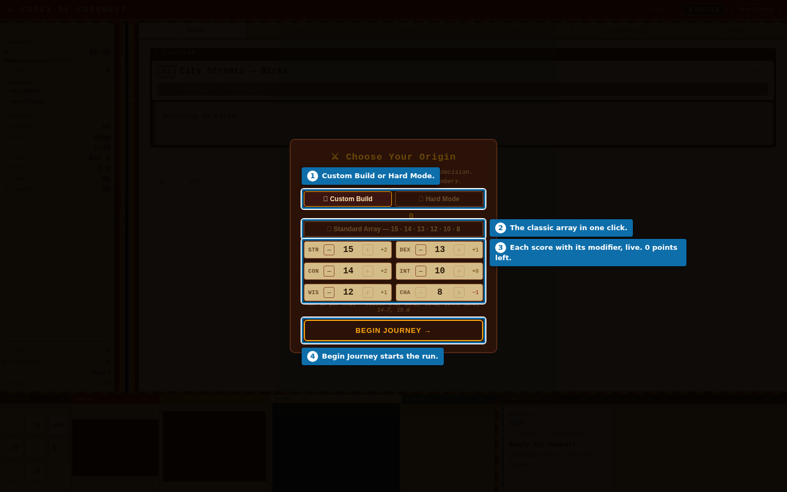

*Choose Your Origin, with the Standard Array spent.*

1. Custom Build or Hard Mode.
2. The classic array in one click.
3. Each score with its modifier, live. 0 points left.
4. Begin Journey starts the run.

The price list is printed under the grid: *Max 15 per stat · costs: 9→1, 10→2, 11→3, 12→4, 13→5, 14→7, 15→9*.

Then the opening frame: a dying courier presses a bloodstained map into your hand and says one word, *"Sweelinck."* The card states the goal of the whole game in four lines.

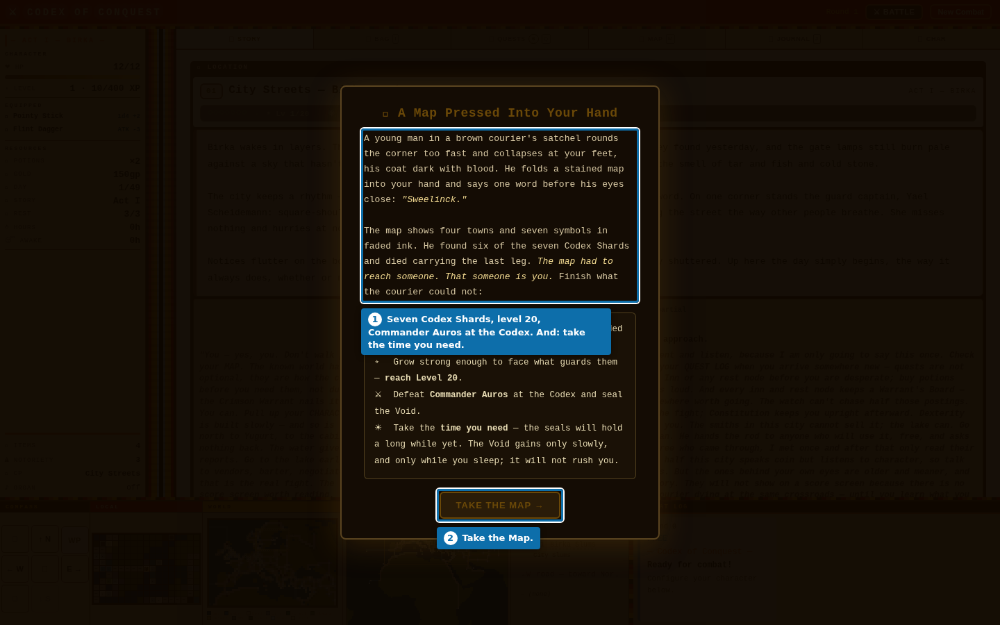

*A Map Pressed Into Your Hand: the goal, stated once.*

1. Seven Codex Shards, level 20, Commander Auros at the Codex. And: take the time you need.
2. Take the Map.

**Check yourself**

- [ ] Which of your six scores will your attacks add?
- [ ] What is your hit point maximum at level 1, and why?

## 3. Birka: reading the screen

**Why it exists.** A MUD describes the world instead of drawing it. The screen keeps the description in the middle and puts everything you would otherwise have to remember (HP, gold, the day, where the exits go, what the last roll was) around it.

**How it fits.** Each later part is one of these regions in use: the tabs open the bag, quests, map, journal and sheet; the compass walks; the combat log records every roll.

The run begins at **City Streets — Birka**, Act I, day 1 of 49, with 12/12 HP and 150 gp. The starting kit is a Pointy Stick in the main hand, a Flint Dagger in the off hand, a Rusted Dagger and two Minor Healing Potions in the pack, and the courier's map.

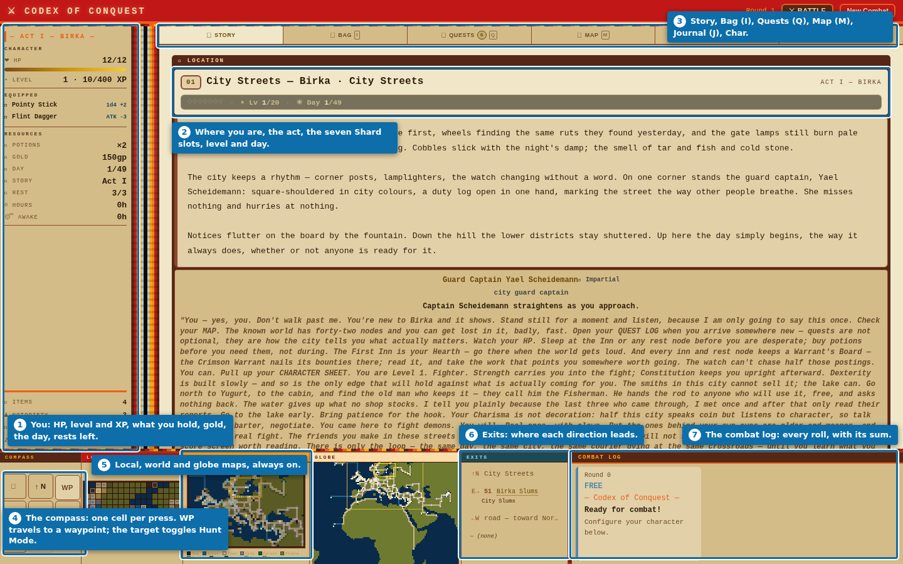

*The story screen in Birka.*

1. You: HP, level and XP, what you hold, gold, the day, rests left.
2. Where you are, the act, the seven Shard slots, level and day.
3. Story, Bag (I), Quests (Q), Map (M), Journal (J), Char.
4. The compass: one cell per press. WP travels to a waypoint; the target toggles Hunt Mode.
5. Local, world and globe maps, always on.
6. Exits: where each direction leads.
7. The combat log: every roll, with its sum.

**Check yourself**

- [ ] Where is the day counter, and what is the last day?
- [ ] Which tab holds the quests, and what is its key?

## 4. People: talk, and favour

**Why it exists.** The story is carried by people, not cut-scenes, and the ending notices whom you befriended. Favour is how the game remembers that you chose a person over efficiency.

**How it fits.** Favour changes what an NPC says, and the friends you keep are named at the end. Many NPCs also give quests, and some sell.

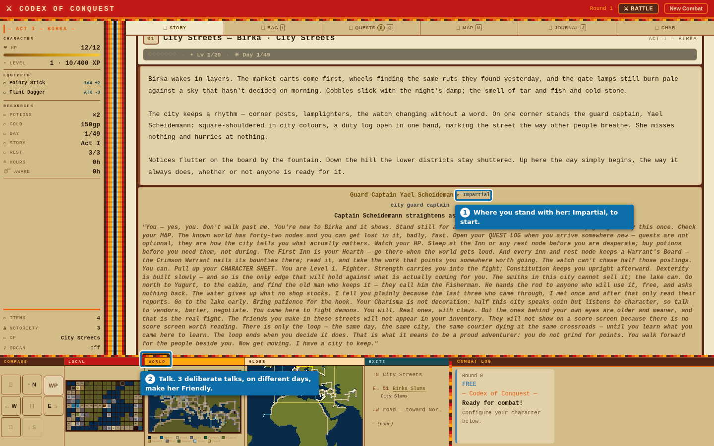

*Guard Captain Yael Scheidemann, the first person you meet.*

1. Where you stand with her: Impartial, to start.
2. Talk. 3 deliberate talks, on different days, make her Friendly.

Her first speech is the game's own tutorial, in character: check the MAP, open the QUEST LOG, sleep at an inn before you are desperate, read the Warrant's Board, and go north to the Fisherman at the lake. The game has 204 NPC profiles (the landing page's count), each with lines for Impartial, Friendly and Dear Friend.

After one talk the button reads **💬 Talk (1/3)**.

## 5. Skill checks, rolled in the open

**Why it exists.** A tabletop game master says the roll out loud: the die, the modifier, the target. The game does the same, and gives you the odds before you commit, so a failure is a risk you took, not a trick.

**How it fits.** The same d20 plus modifier against a number runs attacks, skill checks and saving throws. Checks pay XP, and the ROLL rows sit beside the quests that use them.

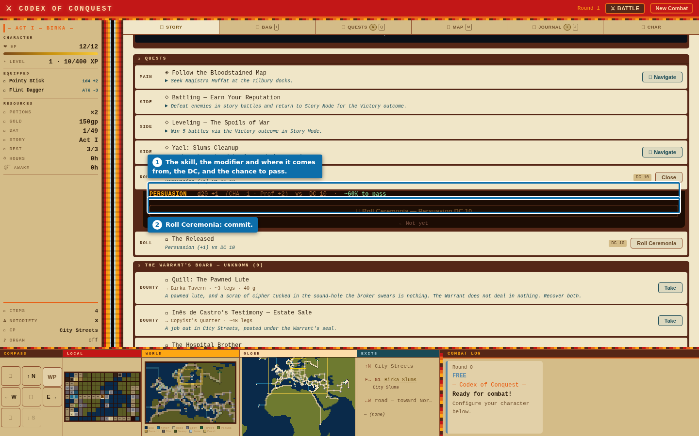

*A skill check, opened.*

1. The skill, the modifier and where it comes from, the DC, and the chance to pass.
2. Roll Ceremonia: commit.

On the screen: `PERSUASION — d20 +1 (CHA -1 · Prof +2) vs DC 10 · ~60% to pass`.

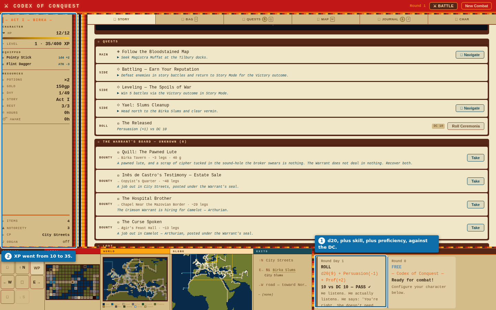

*The result, written into the combat log.*

1. d20, plus skill, plus proficiency, against the DC.
2. XP went from 10 to 35.

The log card read: `Round Day 1 · ROLL · d20(9) + Persuasion(-1) + Prof(+2) · 10 vs DC 10 — PASS ✓`.

**Check yourself**

- [ ] Before rolling, what were the odds, and where did the modifier come from?
- [ ] What did the check pay, pass or fail?

## 6. Quests and the Warrant's Board

**Why it exists.** Quests are how the world tells you what matters. There are 2,853 of them (the landing page's count), so the game needs a log that says the next step, a way to walk there, and a board where optional work is posted.

**How it fits.** Quests are data, not code: each names where it starts, what completes it (often just arriving), and what it pays. Mission bits record what you have done, and later quests and dialogue read them. No quest ever blocks a road.

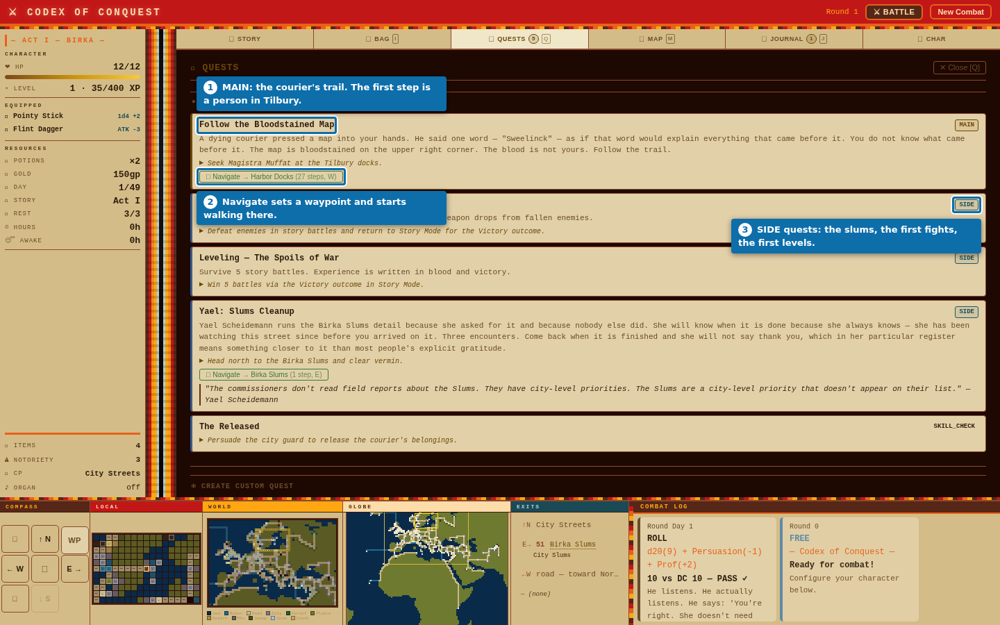

*The quest log (Q).*

1. MAIN: the courier's trail. The first step is a person in Tilbury.
2. Navigate sets a waypoint and starts walking there.
3. SIDE quests: the slums, the first fights, the first levels.

The log listed 5 entries on day 1.

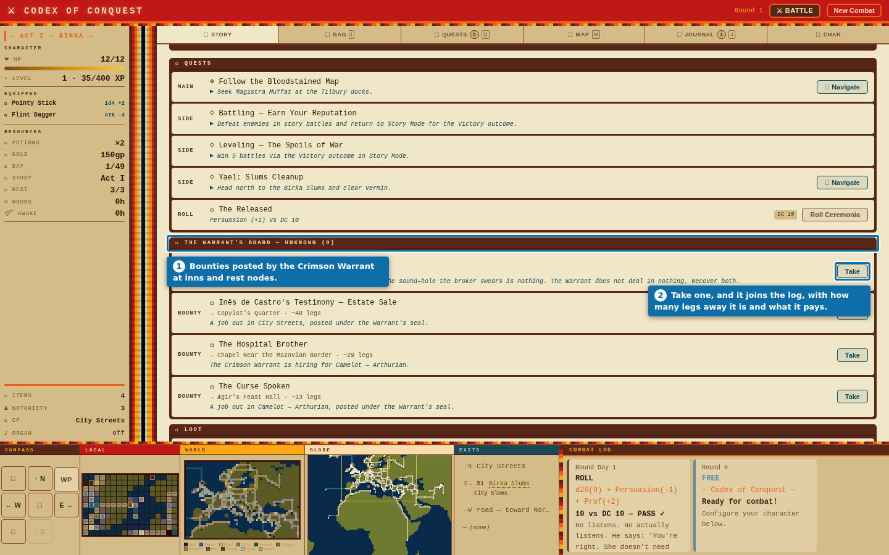

*The Warrant's Board, in the story view.*

1. Bounties posted by the Crimson Warrant at inns and rest nodes.
2. Take one, and it joins the log, with how many legs away it is and what it pays.

The first posting that morning was *Quill: The Pawned Lute*.

## 7. The map, and walking

**Why it exists.** Movement is a system, not a menu. Distance costs time against a 49-day clock, and terrain decides what you meet, so the map has to show where you are, what is around you, and how far it is.

**How it fits.** Every location is a cell on one grid; named places sit on cells and the wilderness fills the rest. Free movement is a rule of the game: a quest, a flag or an item never closes a road.

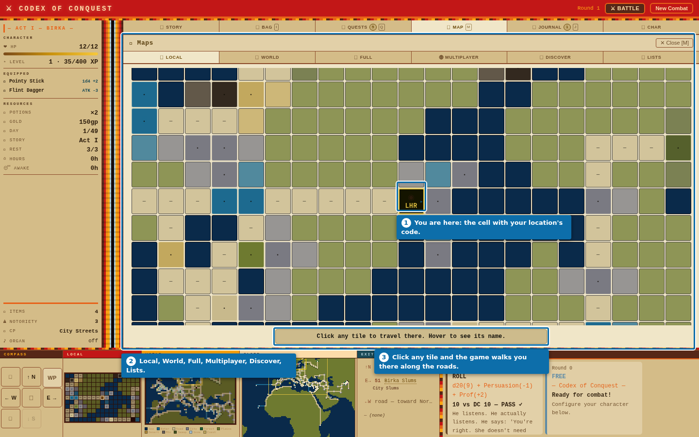

*The map (M), local view.*

1. You are here: the cell with your location's code.
2. Local, World, Full, Multiplayer, Discover, Lists.
3. Click any tile and the game walks you there along the roads.

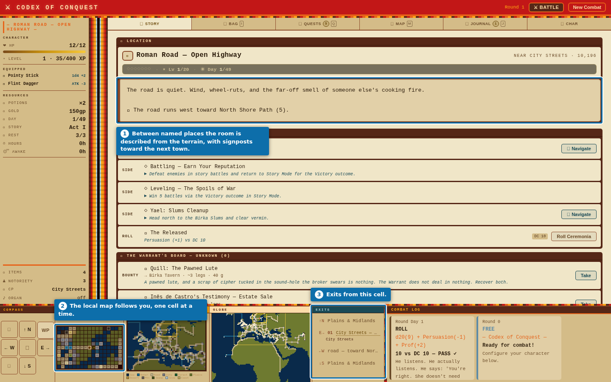

*One step west of the city: a road cell.*

1. Between named places the room is described from the terrain, with signposts toward the next town.
2. The local map follows you, one cell at a time.
3. Exits from this cell.

The first exit list in Birka read: EXITS · ↑N City Streets · E→ 51 Birka Slums. One press of W later the player stood at grid cell r:10,c:196.

Roads and junctions have an encounter rate of zero. Off the road, each step rolls against the terrain's rate, and **Hunt Mode** (the target in the compass) roughly doubles it, favouring monsters at or below your level. Tougher foes can still find you. Later, after a night at the inn, the tour turns it on and walks off the road.

**Check yourself**

- [ ] Name two ways to travel to a far place without pressing a direction each time.
- [ ] Why can walking on a road never start a fight?

## 8. Resting: the clock, and the inn

**Why it exists.** Forty-nine days is the budget, and sleep is what spends it. Resting is where the game makes you weigh healing against time, and the inn is where it saves your place.

**How it fits.** A long rest at an inn heals, resets the three short rests, advances the day, and writes the checkpoint a death returns you to. A short rest costs an hour and rolls a hit die. The Void gains only while you sleep.

Every place without an inn shows the nearest one in its REST card (*Nearest Inn: Smugglers' Passage (NAS)*), with a **Waypoint** button; the **WP** key in the compass then walks you there and any key halts it. The captain had named the First Inn in Birka as the hearth, so the tour set its waypoint (the same call the quest log's Navigate makes) and walked, straight after the map: the captain's advice is to sleep before you are desperate. On the road a sensible traveller does not finish every fight, so after its attack the tour took the safe flee, the bonus action that leaves a fight (it still pays a quarter of the XP).

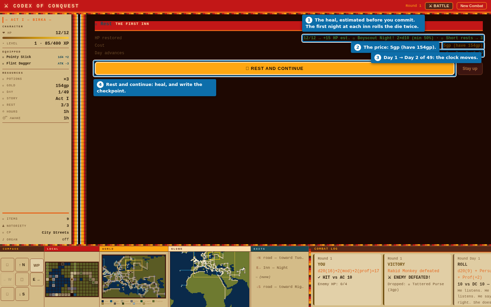

*Resting at The First Inn.*

1. The heal, estimated before you commit. The first night at each inn rolls the die twice.
2. The price: 5gp (have 154gp).
3. Day 1 → Day 2 of 49: the clock moves.
4. Rest and continue: heal, and write the checkpoint.

On the card: `12/12 → +15 HP est. 🏕 Boyscout Night! 2×d10 (min 50%)  ·  🌙 Short rests → 3` · `5gp (have 154gp)` · `Day 1 → Day 2 of 49`.

After the night: 12/12 HP, day 2, checkpoint **TLL**.

**Check yourself**

- [ ] How many days does a long rest cost, and what does it give back?
- [ ] Where will you wake if you die now?

## 9. Combat: the d20, shown

**Why it exists.** Combat is where the tabletop rules matter most, so it hides nothing: armour class, attack bonus, damage dice, initiative and every roll are on the screen, and the log says the sum.

**How it fits.** Wins pay XP, gold and drops into the bag; XP brings levels; a loss brings death saves. Battle XP is the foe's armour class times its hit points, and even a miss earns a little "effort" XP.

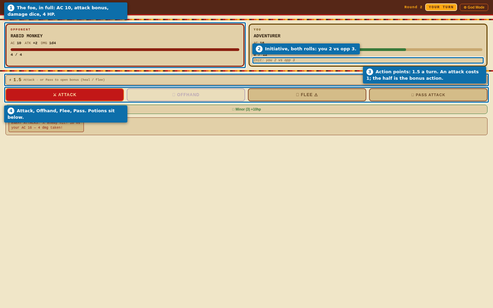

*A wild Rabid Monkey.*

1. The foe, in full: AC 10, attack bonus, damage dice, 4 HP.
2. Initiative, both rolls: you 2 vs opp 3.
3. Action points: 1.5 a turn. An attack costs 1; the half is the bonus action.
4. Attack, Offhand, Flee, Pass. Potions sit below.

The encounter came off the road, Rabid Monkey rolled from the terrain's monster list. The game has 398 monsters across 111 terrains (the landing page's counts), with encounter rates per terrain, so walking somewhere you are not ready for is legible before it is fatal.

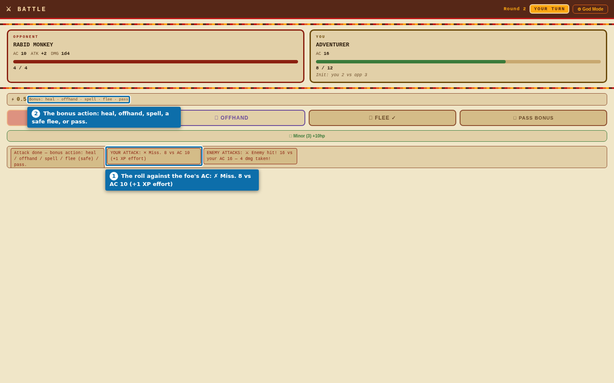

*One attack, and the half action left.*

1. The roll against the foe's AC: ✗ Miss. 8 vs AC 10 (+1 XP effort)
2. The bonus action: heal, offhand, spell, a safe flee, or pass.

A natural 20 is a critical hit and doubles the damage dice; a natural 1 fumbles. The full sum of each roll also goes to the combat log on the story screen.

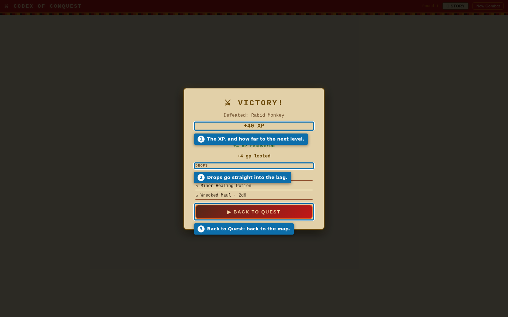

*Victory: what the fight paid.*

1. The XP, and how far to the next level.
2. Drops go straight into the bag.
3. Back to Quest: back to the map.

The banner read: ⚔ VICTORY! · Defeated: Rabid Monkey · +40 XP · Lv 1 · 126 XP · 274 to Lv 2 · +4 HP recovered · +4 gp looted · DROPS.

**Check yourself**

- [ ] What did the foe need to roll to hit you, and why?
- [ ] What does a missed attack still earn?

## 10. Levelling up: roll the hit die yourself

**Why it exists.** A level is the reward for everything above, so the game lets you roll it. The hit die, the feature gained and the sheet it changes are all in front of you.

**How it fits.** Levels unlock the Fighter Champion features (Action Surge, Second Wind, a wider critical range, extra attacks) up to level 20, and each one is recorded as a tattoo.

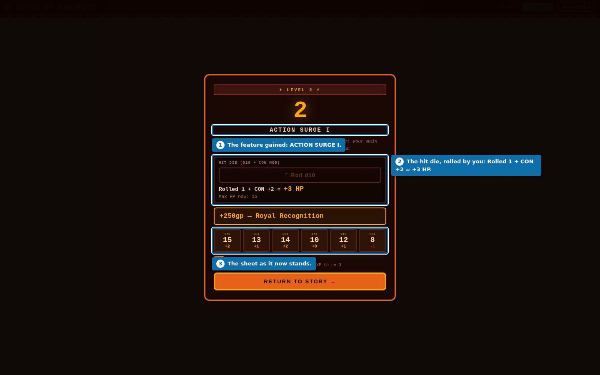

*Level 2, earned in play.*

1. The feature gained: ACTION SURGE I.
2. The hit die, rolled by you: Rolled 1 + CON +2 = +3 HP.
3. The sheet as it now stands.

Reached in the tour after 5 wins: level 2, **ACTION SURGE I**. The roll: `Rolled 1 + CON +2 = +3 HP`.

Level 2 needs 400 XP and level 20 needs 195,000. The character sheet lists every level's feature and the tattoo that marks it, so you can see what is coming.

## 11. Dying, and the checkpoint

**Why it exists.** Dropping to zero should be dangerous but not abrupt. Death saves give you three chances to crawl away, and a death costs the loose loot you carried, left on a corpse where you fell, which you can walk back to.

**How it fits.** Three failed saves and you fall. Your gold and bagged loot stay on your body, as a corpse you can walk back to and reclaim; equipped gear and Codex shards stay with you; a "Fallen" tattoo records the day and the place; and you wake at the checkpoint (the last inn you slept at, Birka before that) with 1 HP. Tattoos and the career chronicle outlive every death.

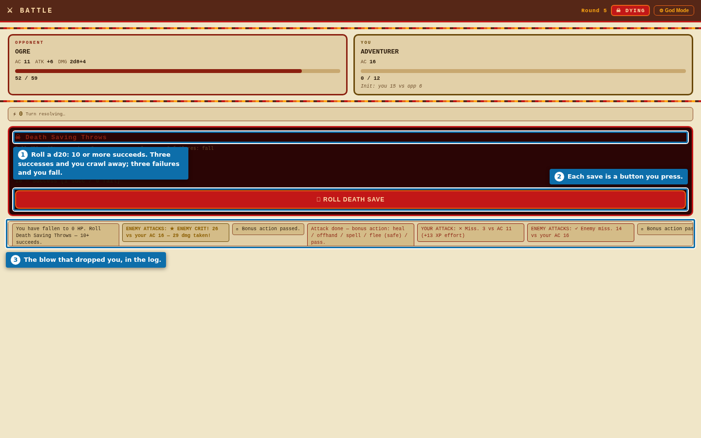

*Dying, in a fight with: Ogre.*

1. Roll a d20: 10 or more succeeds. Three successes and you crawl away; three failures and you fall.
2. Each save is a button you press.
3. The blow that dropped you, in the log.

The tour went down and crawled away. It plays simply: attack, drink a potion below about a third of its HP, take a short rest after a fight when below half, and flee only while travelling to the inn.

**Check yourself**

- [ ] How many failed death saves end a life?
- [ ] What survives a death, and what is left on the corpse?

## 12. The bag and the character sheet

**Why it exists.** A fighter is what he carries and what he has become. The bag sorts things by what they are for; the sheet shows every number a roll uses, so nothing is computed behind your back.

**How it fits.** Drops from fights land in the bag; the equipped weapon sets the damage dice in combat; the shard and Void counters are the campaign's score; the tattoos are the record that survives death and New Game+.

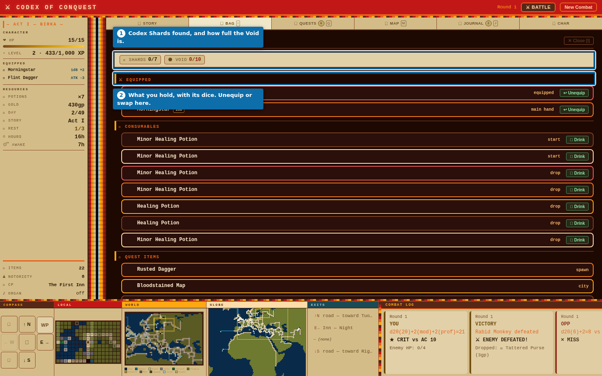

*The bag (I), 22 items after the tour's fights.*

1. Codex Shards found, and how full the Void is.
2. What you hold, with its dice. Unequip or swap here.

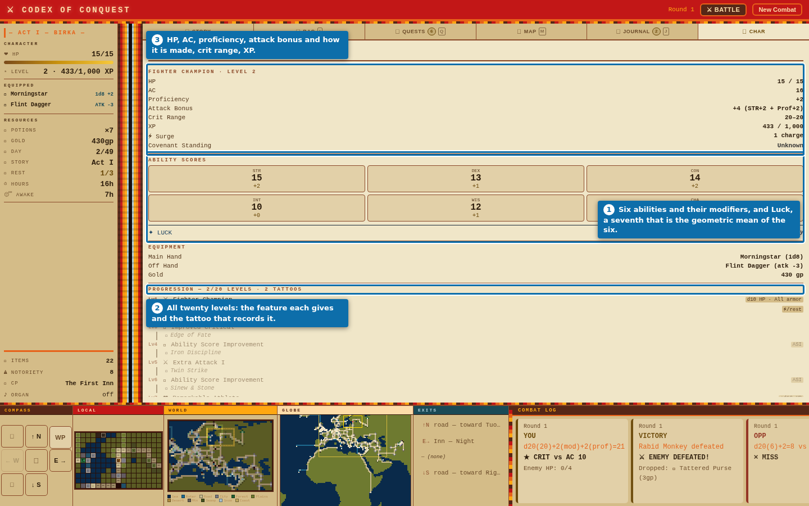

*The character sheet.*

1. Six abilities and their modifiers, and Luck, a seventh that is the geometric mean of the six.
2. All twenty levels: the feature each gives and the tattoo that records it.
3. HP, AC, proficiency, attack bonus and how it is made, crit range, XP.

Luck on this sheet: `geometric mean of all stats — read-only`. Further down, the **Chronicle** counts this life and the whole career: kills, deaths, battles, hit rate, damage, exits taken, sleeps.

## 13. The journal, and the save

**Why it exists.** The story is told partly by a dead man. Froberger's journal is found a page at a time across the world, and a run is long, so the game saves itself after every meaningful action and asks, each time you open it, whether to go on.

**How it fits.** Journal entries are found by arriving at places (the First Inn hands you one). The autosave holds the whole state; the checkpoint holds the last night at an inn. Both live in your browser and nothing is uploaded.

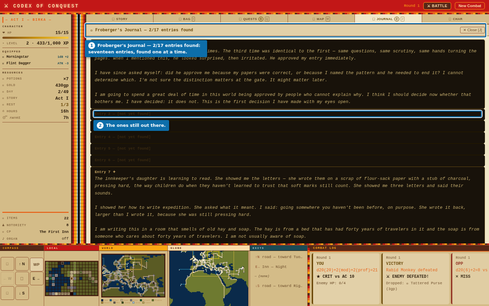

*Froberger's Journal (J).*

1. Froberger's Journal — 2/17 entries found: seventeen entries, found one at a time.
2. The ones still out there.

In New Game+ you write the next entry, Entry 42, yourself; the journal and the tattoos carry over.

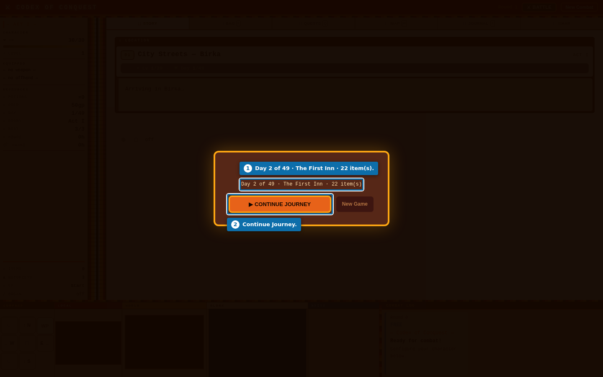

*The same page, reloaded: the run is still there.*

1. Day 2 of 49 · The First Inn · 22 item(s).
2. Continue Journey.

At that moment the browser held an autosave of 16,917 characters (`coc_autosave`) and a checkpoint of 14,828 (`coc_checkpoint`). Both keys hold JSON in `localStorage`, on your machine only. The README mentions **Export Save** and **Import Save** buttons; this build of `play.html` has none, so moving a run between browsers means copying those two keys.

## 14. How it fits together

**Why it exists.** The game is one loop: read a place, choose a verb, roll in the open, and let the world remember. Every system exists to feed that loop or to keep it honest.

**How it fits.** Each row below is a part of this guide; the third column is why it would not be enough alone.

| Stage | Feature | Why it is not enough alone |
| --- | --- | --- |
| Begin | Origin, point-buy, the courier's map | A sheet and a goal say who you are and where to go, not how to get there. |
| Read | The story screen, NPCs and favour | A place described is a place you still have to act in. |
| Decide | Skill checks with the odds shown | A check resolves one moment; quests string the moments into a story. |
| Go | Quests, the Warrant's Board, the map, waypoints | Walking costs time and meets monsters on the way. |
| Fight | Initiative, the d20 against AC, action points | A won fight pays XP and drops; a lost one needs a way back. |
| Grow | XP, levels, tattoos, the bag | Strength without rest runs out; the clock and the Void keep counting. |
| Endure | Short and long rests, death saves, the checkpoint | The inn saves your place, but each night spends one of 49 days. |
| Remember | Mission bits, the journal, the chronicle, the autosave | The world knows what you did; the ending names the friends you kept. |

Beyond this tour: fishing at the lakes (shore, reeds and deep water unlock separately), vendors, the twenty Epic Battlegrounds where Void pressure builds, New Game+, and an optional peer **mesh** for presence, chat and consensual duels when the local server runs. All of it is in the same file.

Behind the game sits the authoring side: `edit.html`, a visual editor for nodes, terrains, monsters, quests, NPCs and mission bits, which needs the local WBAPI server (`make wbapi`). World data goes in through that API, and `make check` runs the gates that look for dead links, unreachable nodes, duplicate keys and quests that can never complete.
